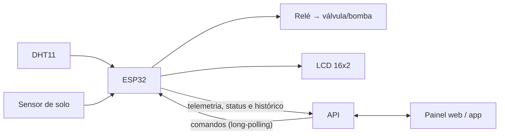

# SmartIrrigation — Coletor (ESP32)

Firmware do **coletor** do SmartIrrigation, o sistema de irrigação inteligente para agricultura sustentável. O coletor é o ESP32 instalado no campo. Ele:

- lê a temperatura e a umidade do ar (DHT11) e a umidade do solo;
- envia essas leituras para a API;
- recebe comandos do painel (irrigar, parar, trocar modo, atualizar parâmetros);
- no **modo automático**, decide sozinho quando e quanto irrigar, com base na evapotranspiração da cultura;
- aciona o relé que liga a válvula ou bomba.

| Parte | Repositório |
|---|---|
| **Coletor** (este) | [`smart-irrigation-colector`](https://github.com/jorgearaujor/smart-irrigation-colector) |
| API (Spring Boot + Firebase) | [`smart-irrigation-api`](https://github.com/jorgearaujor/smart-irrigation-api) |
| Painel web (Angular) | [`smart-irrigation-front`](https://github.com/jorgearaujor/smart-irrigation-front) |
| App mobile (Android) | [`SmartIrrigation`](https://github.com/jorgearaujor/SmartIrrigation) |



---

## Arquivos

| Arquivo | Descrição |
|---|---|
| `irrigation_controller_esp32.ino` | Firmware completo (abre direto na Arduino IDE) |
| `secrets.example.h` | Modelo das credenciais. Copie para `secrets.h` |
| `secrets.h` | Suas credenciais reais. **Não vai para o Git** (está no `.gitignore`) |

## Hardware

| Componente | Função | Pino (ESP32) |
|---|---|---|
| ESP32 Dev Module | Microcontrolador com Wi-Fi | — |
| DHT11 | Temperatura e umidade do ar | GPIO 27 |
| Sensor de umidade do solo (saída analógica) | Umidade do solo | GPIO 34 (ADC, só entrada) |
| Módulo relé | Liga/desliga a válvula ou bomba | GPIO 26 |
| LCD 16x2 com módulo I2C (endereço `0x27`) | Mostra temperatura, umidade e modo | SDA GPIO 21 / SCL GPIO 22 |

Os pinos podem ser alterados nas constantes `RELAY_GPIO_PIN`, `DHT_PIN` e `SOIL_ADC_PIN`. O LCD é opcional: para desligar, use `LCD_ENABLED false`.

O relé sempre começa **desligado** quando o ESP32 liga, por segurança.

## Como gravar

1. Instale a [Arduino IDE](https://www.arduino.cc/en/software) e o suporte às placas ESP32 (Gerenciador de Placas → "esp32" da Espressif).
2. Instale as bibliotecas pelo Gerenciador de Bibliotecas:
   - **DHT sensor library** (Adafruit) e **Adafruit Unified Sensor**
   - **LiquidCrystal_I2C** (marcoschwartz)
   - **ArduinoJson** (bblanchon, versão 7)
3. Copie `secrets.example.h` para `secrets.h`, na mesma pasta do `.ino`, e preencha:

   | Campo | O que colocar |
   |---|---|
   | `WIFI_SSID` / `WIFI_PASSWORD` | Rede Wi-Fi do local |
   | `API_BASE_URL` | Endereço da API, **sem** `/api` no final |
   | `DEVICE_ID` | Identificador do coletor (o painel usa `esp32-01`) |
   | `DEVICE_API_KEY` | Igual ao `DEVICE_API_KEY` configurado na API |

   Para gerar uma chave nova:

   ```bash
   openssl rand -hex 32
   ```

4. Abra o `.ino`. A Arduino IDE pode pedir para criar uma pasta com o mesmo nome do arquivo: aceite e coloque o `secrets.h` junto.
5. Selecione a placa **ESP32 Dev Module** e a porta USB e clique em **Carregar**.
6. Abra o Monitor Serial em **115200 baud** para acompanhar os logs.

## Calibração do sensor de solo

A umidade do solo é calculada a partir da tensão lida no ADC (média de 16 leituras):

```
umidade (%) = (SOIL_MAX_VOLTAGE − tensão) / (SOIL_MAX_VOLTAGE − SOIL_MIN_VOLTAGE) × 100
```

| Constante | Significado | Padrão |
|---|---|---|
| `SOIL_MAX_VOLTAGE` | Tensão com o sensor **seco** (0 %) | 2,8 V |
| `SOIL_MIN_VOLTAGE` | Tensão com o sensor **dentro da água** (100 %) | 1,2 V |

Cada sensor é um pouco diferente. Depois de montar, meça os dois extremos e ajuste as constantes.

## Funcionamento

### Ao ligar

1. Conecta no Wi-Fi.
2. Sincroniza o relógio pela internet (NTP) e aplica o fuso de Brasília (UTC−3).
3. Inicializa relé, sensores e LCD.
4. Busca na API a última configuração salva: modo, autorização, latitude e parâmetros agronômicos. Se a API não responder, usa os valores padrão do firmware.
5. Inicia as tarefas em paralelo.

### Tarefas (FreeRTOS)

| Tarefa | Frequência | O que faz |
|---|---|---|
| `sensorTask` | a cada 10 s | Lê os sensores, envia a telemetria, atualiza o LCD e verifica se deve irrigar no modo automático |
| `statusSyncTask` | a cada 20 s | Envia o status atual para a API |
| `commandPollTask` | contínua | Espera comandos do painel (long-polling de até 30 s) |
| `irrigationTask` | quando há irrigação | Mantém o relé ligado pelo tempo calculado e registra o histórico no fim |

Os dados compartilhados entre as tarefas são protegidos por *mutex*, e só uma irrigação roda por vez.

### Modo automático

O coletor só irriga sozinho quando as **três** condições são verdadeiras:

1. o modo está em `automatico`;
2. a irrigação automática está **autorizada** no painel;
3. a umidade do solo está **abaixo do limiar** configurado (padrão 50 %).

A quantidade de água é calculada assim:

| Passo | Cálculo |
|---|---|
| 1. Evapotranspiração de referência (Hargreaves-Samani) | `ETo = 0,0023 × Ra × √(Tmax − Tmin) × (Tmédia + 17,8)` em mm/dia. `Ra` (radiação extraterrestre) vem da latitude e do dia do ano. `Tmin` e `Tmax` são as temperaturas mínima e máxima registradas desde que o coletor ligou |
| 2. Evapotranspiração da cultura | `ETc = ETo × Kc` (o Kc vem da cultura e da fase escolhidas no painel) |
| 3. Volume por planta | `ETc × espaçamento entre plantas × espaçamento entre linhas` (1 mm em 1 m² = 1 L) |
| 4. Tempo de irrigação | `volume por planta ÷ (vazão do gotejador × gotejadores por planta)` |
| 5. Volume total | `volume por planta × número de plantas` |

### Modo manual

O usuário informa no painel o volume total em litros. O coletor converte esse volume em tempo pela vazão total do sistema (`vazão do gotejador × gotejadores por planta × número de plantas`) e liga o relé por esse tempo. O comando de parar interrompe a irrigação em até meio segundo.

### Parâmetros padrão

Valores usados até a API enviar os configurados no painel:

| Parâmetro | Padrão |
|---|---|
| Kc | 1,40 |
| Espaçamento entre plantas / entre linhas | 0,3 m / 0,3 m |
| Vazão do gotejador | 2,0 L/h |
| Gotejadores por planta | 1 |
| Número de plantas | 30 |
| Umidade mínima do solo | 50 % |

## Comunicação com a API

Toda chamada leva o cabeçalho `X-Device-Key: <DEVICE_API_KEY>`. Se um envio falhar, o coletor tenta de novo até 5 vezes, com espera crescente (2 s, 4 s, 8 s…).

### O que o coletor envia

| Método | Rota | Conteúdo |
|---|---|---|
| POST | `/api/ingest/telemetry` | `deviceId`, `temperature`, `humidity`, `soilPercent`, `timestamp` |
| POST | `/api/ingest/status` | `deviceId`, `modo`, `autorizado`, `quantidadeAgua`, `tempMin`, `tempMax`, `emExecucao`, `latitude` |
| POST | `/api/ingest/history` | `deviceId`, `umidadeAtual`, `tempo`, `volumePorPlanta`, `volumeTotal`, `data`, `hora`, `modo` |
| GET | `/api/devices/{id}/config` | Busca a configuração inicial ao ligar |
| GET | `/api/devices/{id}/commands/poll` | Espera o próximo comando (`200` com comando ou `204` sem nada) |

### Comandos aceitos

| Comando | Conteúdo | Efeito |
|---|---|---|
| `START_IRRIGATION` | `quantidade_agua` | Inicia a irrigação manual. É ignorado se não estiver no modo manual ou se já estiver irrigando |
| `STOP_IRRIGATION` | — | Para a irrigação em andamento |
| `MODE_CHANGE` | `modo` (`manual` / `automatico`) | Troca o modo |
| `AUTHORIZATION_CHANGE` | `autorizado` | Libera ou bloqueia o modo automático |
| `LATITUDE` | `latitude` | Atualiza a latitude usada no cálculo |
| `CONFIG_IRRIGACAO` | `kc`, `espacamento_plantas_m`, `espacamento_linhas_m`, `vazao_gotejador_lph`, `num_gotejadores_planta`, `numero_total_plantas`, `limiar_umidade_minima` | Atualiza os parâmetros agronômicos |

## Problemas comuns

| Sintoma | Causa provável |
|---|---|
| Fica em "Conectando ao WiFi....." | SSID ou senha errados em `secrets.h`, ou rede de 5 GHz (o ESP32 só usa 2,4 GHz) |
| `HTTP 401` / `403` nos envios | `DEVICE_API_KEY` diferente da configurada na API |
| `HTTP -1` nos envios | `API_BASE_URL` errado ou API fora do ar. Hospedagens gratuitas podem levar até 1 minuto para "acordar" |
| `Falha ao ler temperatura do DHT11` | Fiação do DHT11 ou falta do resistor de pull-up no pino de dados |
| Umidade do solo sempre 0 % ou 100 % | Sensor sem calibração (veja [Calibração](#calibração-do-sensor-de-solo)) |
| LCD aceso sem texto | Endereço I2C diferente de `0x27` (teste `0x3F`) ou contraste no potenciômetro |
| `secrets.h: No such file or directory` | Falta copiar o `secrets.example.h` para `secrets.h` |

## Licença

[MIT](LICENSE) © 2026 Jorge Afonso
